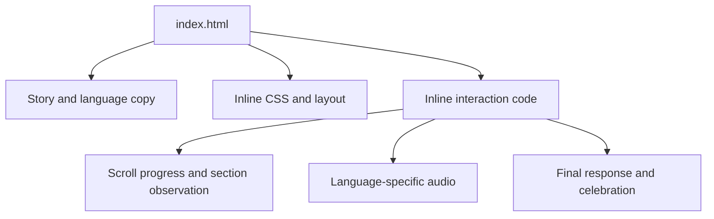

# Valentine's Day Journey

An interactive Valentine's gift built to tell a personal story through language, scrolling, animation, and music.

**[Open the live experience](https://valentinesdaypresentformybubu.netlify.app/)**

## What it does

- Presents a sequence of story sections inside a scroll-snap container.
- Switches between English and Hindi copy and the corresponding audio tracks.
- Updates an SVG path with scroll progress and reveals sections using browser observation.
- Responds to the final choice with a custom celebration flow.

HTML · CSS · JavaScript. This is a personal browser experience, not a commercial service.

## How it is organized



The implementation lives in [index.html](index.html), including styles and scripts. [script.js](script.js) is intentionally a stub. Local music files are under [music/](music/); Google Fonts is an external dependency.

## Run locally

No dependency installation or build is required. Serve the repository root using any static HTTP server. With Python installed:

```sh
python -m http.server 8080 --bind 127.0.0.1
```

Open `http://127.0.0.1:8080`. An HTTP preview is preferable to assuming all media/browser behavior is identical under `file://`.

## Review notes

Check both languages, story progression, final-choice behavior, and audio after a user gesture. Browser autoplay policy can prevent sound until interaction. No automated regression suite, measured 60fps claim, or complete accessibility/reduced-motion audit is established by this README.

The site's expressive visual effects belong to this personal gift; documentation uses a quieter structure. No license file is currently included, so the former MIT badge did not establish a repository license. Personal media and third-party assets are not licensed for reuse merely because the source is visible.
